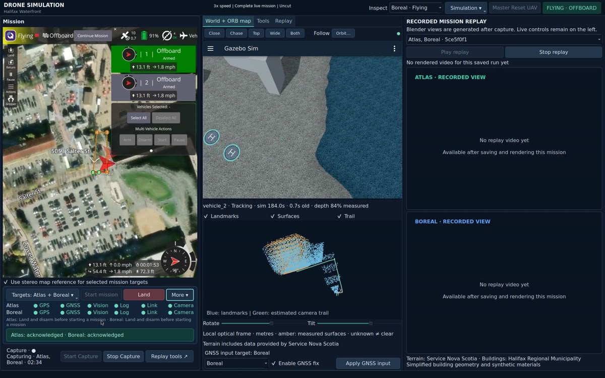

# Multi-Drone Flight Simulation and Visual Navigation

A desktop flight laboratory that brings two simulated aircraft, mission controls,
visual localization and reproducible replay into one workspace.

### GPS-loss highlight (45 seconds)

https://github.com/user-attachments/assets/99722bf5-903f-432d-b478-221f1d790064

**[Watch the full demo on YouTube (4:35)](https://youtu.be/YoDmhJst84I)** |
[Download the full MP4](docs/media/waterfront-full-demo.mp4)

Two drones, a waterfront mission and a GPS-loss return. The full recording
shows setup, live flight, landing, saving and offline Blender replay, with speed
changes labelled throughout.

## How it works



- **PX4 SITL + Gazebo Harmonic** model flight control, vehicle dynamics, terrain and
  sensors. Keeping physics separate from the viewer lets displays restart independently.
- **QGroundControl + Qt** provide mission planning, explicit vehicle targeting, fault
  controls, sensor health and an embedded world/reconstruction view.
- **ORB-SLAM3 + stereo perception** estimate motion from camera observations. Measured
  free space feeds a conservative occupancy grid and uniform-cost path search.
- **MAVLink, ROS 2 Jazzy and DDS** connect control, telemetry and simulation clocks
  through explicit adapters, identities and bounded queues.
- **Blender + FFmpeg** turn retained poses and actual application recordings into
  timestamp-aligned replay. Rendering runs offline, outside the control loop.

The waterfront demonstration uses camera-based localization **and measured LiDAR
ranges for obstacle sensing**. Boreal loses GPS during return while Atlas retains it;
both return home. It is not a camera-only obstacle-avoidance demonstration. Geographic
buildings are simplified municipal extrusions, materials are synthetic, and ground
truth is reserved for evaluation and replay.

## Run with Docker

Use Linux containers and Docker Compose. Initial builds compile substantial dependencies.
For the visible Windows workspace, Docker Desktop and working WSLg are required:

```powershell
Copy-Item .env.example .env
docker compose up --build
```

On native Linux, provide an authorized X11/XWayland display and writable output storage:

```sh
cp .env.example .env
docker compose -f compose.yaml -f deploy/compose/linux.yaml up --build
```

For the portable headless stack:

```sh
docker compose -f compose.yaml --env-file configs/runtime/headless.env up --build
```

The API is local-only at `http://127.0.0.1:18080`. Use `docker compose ps` and
`docker compose logs -f control-panel gazebo` to inspect startup. Select vehicles
explicitly before issuing commands; wait for confirmed landing/disarm before reset.
`docker compose down` stops services while preserving recorded outputs.

The base stack and the waterfront/replay profiles have different dependencies.
[Portability and display setup](docs/RUNNING.md),
[waterfront assets and operation](docs/USER_GUIDE.md), and
[native recording and replay](docs/USER_GUIDE.md) document the optional
images, overlays, retained aircraft assets and licensed terrain/building preparation.
Those geographic datasets are not bundled in Git, and a clean checkout does not
reproduce the waterfront scene without preparing them.

## Design principles

Explicit vehicle identity and command ownership; fresh observations before motion;
unknown space stays unknown; bounded recording and cancellable background work;
separate UTC and simulation time; durable data outside container lifetimes.

Optional deployment overlays live in `deploy/compose`; the default Compose files remain
at the repository root.

`src/desktop` composes the UI, `src/common` owns application contracts and lifecycle,
`src/integrations` contains protocol and sensor adapters, and `configs` holds declarative
inputs. Generated recordings and reports belong in ignored `outputs/`; curated README
media lives in `docs/media`.

See the [documentation index](docs/README.md), [architecture](docs/ARCHITECTURE.md), [development and checks](docs/DEVELOPMENT.md)
and [release checks](docs/RELEASE_CHECKS.md) and
[demo measurements and limitations](docs/media/DEMO-NOTES.txt). This is a simulation
workspace, not a certified flight system or an internet-facing control service.
